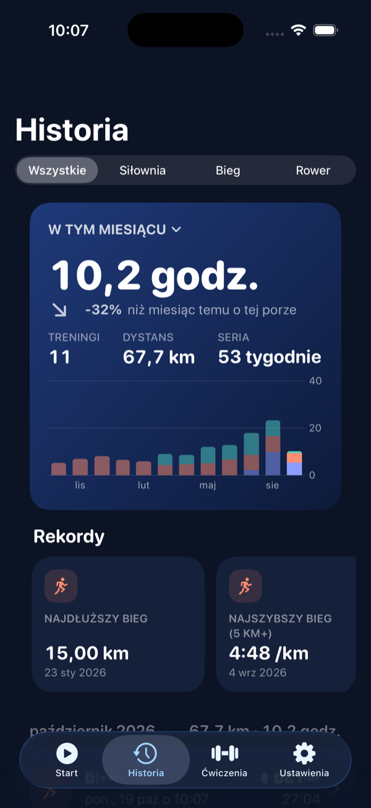
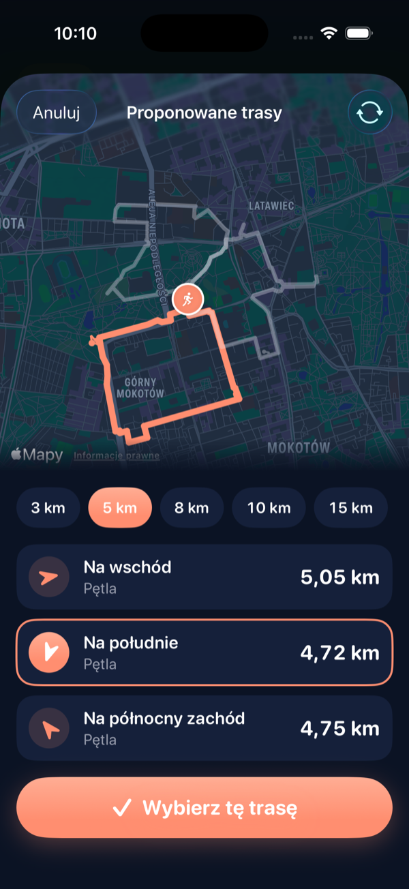

# Biegocz

A personal iPhone app for logging gym workouts and GPS-tracked runs and rides. Everything stays on the device: no account, no backend, no sync. Available in English and Polish.

<p>
  
  
  
  
  
</p>

## Features

**Gym**
- Library of 44 common exercises grouped by muscle group, plus your own custom exercises (rename, archive).
- Fast logging: weight and reps steppers sized for sweaty hands, sets prefilled from your last session, and a "Last time: 3 × 8 @ 80 kg" hint.
- Rest timer with +30 s and skip, plus a notification when rest is over and the app is in the background.
- Repeat a past workout with one tap.
- Per-exercise history with best set, estimated 1RM (Epley) and a progress chart.

**Run and ride**
- GPS tracking that keeps going with the screen locked, with a live map, pace or speed, and moving vs. elapsed time.
- Filtering of noisy, stale and impossible GPS fixes, plus optional auto-pause.
- Per-kilometer splits, approximate elevation gain (barometer when available), and a route map.
- Crash-safe: progress is saved every 10 seconds, and an interrupted session can be resumed, saved or discarded.
- Suggested routes: pick a distance and get three loops around you (Apple Maps directions), then follow the chosen one on the live map.

**History**
- Overview of the week, month or year with a chart, the change against the same point of the previous period, a weekly streak and personal bests.
- Filter by gym, run or ride; months show their totals.

**Everywhere**
- Saves workouts and routes to Apple Health, if you allow it. The app works fully without it.
- Export everything as JSON (plus a CSV of all gym sets) and import it back.
- Import past runs and rides, with maps, from a Strava account export or MapMyRun (GPX, TCX and FIT files, also gzipped). Duplicates are skipped.
- Full Polish translation with correct plural forms and a decimal comma ("5,2 km").
- Light, dark or automatic appearance, and English or Polish regardless of the device language.
- Haptics and animations that respect Reduce Motion.

## Requirements

- iPhone with iOS 26 or later
- Xcode 26

## Getting started

1. Open `Biegocz.xcodeproj` in Xcode.
2. Under **Signing & Capabilities**, choose your team and, if needed, change the bundle identifier (`com.gajtkowski.biegocz`).
3. Run on an iPhone or the simulator.

The simulator has no HealthKit and no real GPS, so simulator builds use fakes: Health is turned off, and runs and rides replay the sample routes in `Biegocz/Resources/GPX/` (a ~5 km run loop and a ~20 km ride).

## Development

Build and test from the command line:

```sh
scripts/build.sh          # build the app and tests
scripts/build.sh test     # build and run all tests, printing failures
python3 scripts/check_strings.py   # every string is in the catalog with Polish
```

Look at a screen in the simulator with demo data (debug builds only, in-memory store):

```sh
scripts/screenshot.sh gym pl dark
```

Other scripts:

| Script | Purpose |
| --- | --- |
| `scripts/add_strings.py` | Merge new translations into `Localizable.xcstrings` |
| `scripts/make_colors.py` | Generate the color palette asset sets |
| `scripts/make_icon.swift` | Render the app icon |
| `scripts/make_sample_gpx.py` | Generate the simulator GPX routes |
| `scripts/mapmyrun_export.py` | Download your MapMyRun workouts as TCX files for importing |
| `scripts/store_screenshots.sh` | App Store screenshots (6.9", English and Polish) into `build/store/` |

Publishing to the App Store: see [`docs/RELEASE.md`](docs/RELEASE.md). The listing text is in `docs/app-store/`, and the privacy policy and support pages (served by GitHub Pages from `docs/`) are in `docs/privacy.md` and `docs/support.md`.

### Importing history

- **Strava**: on strava.com, go to Settings → My Account → Download or Delete Your Account and request your archive. Unzip the email attachment (the Files app can do it), then in Biegocz choose Settings → Import from Strava or MapMyRun and pick the folder.
- **MapMyRun**: there's no bulk export with routes. Log in at mapmyrun.com, copy the `Cookie` request header from your browser's developer tools into a file, and run `python3 scripts/mapmyrun_export.py build/mapmyrun_cookie.txt build/mapmyrun`. It downloads one TCX file per workout. Copy the folder to your iPhone and import it the same way, then delete the cookie file.

### Project layout

```
Biegocz/
  App/              entry point, tabs, session coordinator, design system
  Core/Models/      SwiftData models, versioned schema, migration plan
  Core/Persistence/ store, seed data, route encoding, JSON/CSV export and import
  Core/Import/      GPX, TCX and FIT readers for importing history
  Core/Metrics/     pure logic: GPS filtering, pace, splits, auto-pause, e1RM, prefill
  Core/Location/    location and altitude providers (real + simulator fakes)
  Core/Health/      HealthKit store (real + no-op) and saving workouts
  Features/         Start, Gym, Cardio, History, Exercises, Settings
BiegoczTests/       Swift Testing suite
```

Stack: Swift 6, SwiftUI, SwiftData, MapKit, Swift Charts, CoreLocation, CoreMotion and HealthKit. No third-party dependencies.

The full product spec and project rules live in [`CLAUDE.md`](CLAUDE.md).
